# multi-model-kit

Run Claude as the orchestrator of a Claude + GPT + Gemini team: route work by strength, cross-review between vendors, hand off across sessions and machines, and keep going when a rate limit hits.

English | [简体中文](README_ZH.md)

<p align="center">
  <a href="https://thejason1997.github.io/multi-model-kit/">
    <picture>
      <source media="(prefers-color-scheme: dark)" srcset="docs/architecture/story-dark.svg">
      
    </picture>
  </a>
</p>

<p align="center">
  <a href="https://thejason1997.github.io/multi-model-kit/"><b>Open the interactive version</b></a>
  (scrub the story, click any node, search, switch theme)
</p>

It is a set of plain files that sit on top of [Claude Code](https://claude.com/claude-code), T3 Code and the compound-engineering plugin: one block of global rules, three skills, a launcher, and a Claude Code mod. There is no server and no dependency to install beyond the tools you already use.

## What it does

| Problem | What the kit does |
|---|---|
| One model does everything, including what it is worst at | The orchestrator routes by strength. Claude takes UI, architecture and reading the codebase. GPT takes backend, hard bugs and research. Gemini takes docs, copy and ideas. |
| A model grades its own work | The reviewer is never the author's vendor. It blocks only on harm it can describe, for two rounds at most. Then you decide. |
| A rate limit stops the task | At 80% of a window the session spends less. At 95% a launcher restarts Claude under your second org and resumes the same conversation. If every org is limited, Codex continues in the foreground. |
| A new session or another machine starts from zero | Code and `.handoff.md` land in the same commit, so a cloud session, your phone or tomorrow's session can pick up from the branch alone. |

## How it works

Each diagram is interactive: click a node to see what feeds it and what it feeds.

1. **[Overview](https://thejason1997.github.io/multi-model-kit/architecture/overview.html).** You ask once. The orchestrator reads the shared rules and picks the lightest route that works: answer directly, hand off to one executor, use part of the process, or run the full process.
2. **[One unit of work](https://thejason1997.github.io/multi-model-kit/architecture/dispatch.html).** A brief with six fields goes to one executor in its own git worktree. Edits come back uncommitted. The orchestrator reruns the checks, commits, and sends the diff to a reviewer from another vendor.
3. **[Rate limits](https://thejason1997.github.io/multi-model-kit/architecture/quota.html).** `claude-org` keeps one login per org in its own config directory and never reads a credential. The mod hands the session id to the launcher, which restarts Claude under the other org.
4. **[Handoff](https://thejason1997.github.io/multi-model-kit/architecture/handoff.html).** `.handoff.md` holds the board (your words, decisions, each executor's conclusion) and nine handoff notes. A signal branch calls a cloud session back.

## What is inside

| Path | What it is |
|---|---|
| `rules/multi-model.md` | The global rules, about 15 lines. `install.sh` writes them between a pair of markers. |
| `skills/dispatch/` | Routing table, brief template, receipt format, fallback chain, roundtable. |
| `skills/task-handoff/` | The `.handoff.md` template and the steps for each unit, going to the cloud, and coming back. |
| `skills/prompt-library/` | 12 thinking prompts and a table for choosing among them. |
| `bin/claude-org` | Launcher: starts Claude under one org and restarts it under another when the mod asks. |
| `bin/quota-status` | Prints the last quota readings and whether the session is saving quota. |
| `mods/org-switch/` | Claude Code mod: watches the quota windows, lowers effort at 80%, hands over at 95%, adds `/org`. |
| `docs/architecture/` | The diagrams above, their JSON sources, and `build.sh` to rebuild them. |

The rules and skills are written in Chinese. The models follow them in any conversation language.

## Install

```sh
git clone https://github.com/TheJason1997/multi-model-kit.git
cd multi-model-kit
sh install.sh --check   # report only, changes nothing
sh install.sh           # link the skills and quota-status and write the rules
```

`install.sh` covers three tools and skips any whose config directory does not exist:

| Tool | Rules go into | Skills are linked into |
|---|---|---|
| Claude Code | `~/.claude/CLAUDE.md` | `~/.claude/skills/` |
| Codex | `~/.codex/AGENTS.md` | `~/.agents/skills/` |
| Gemini CLI | `~/.gemini/GEMINI.md` | `~/.gemini/skills/` |

The installer links the `quota-status` command at `~/.local/bin/quota-status` to this repository's `bin/quota-status`. Remove that symlink to uninstall the command.

Running it again changes nothing. It leaves everything outside its markers byte for byte as it was, writes through a symlinked instruction file, and stops before writing anything if any destination conflicts: a skill of the same name that is not ours, a read-only or dangling file, a directory it cannot write to, unpaired markers, or marker lines with CRLF endings.

Known limit: when `~/.codex/AGENTS.override.md` exists, Codex may read only that file. The installer does not handle it.

To remove the kit, delete the block from `<!-- BEGIN multi-model-kit -->` to `<!-- END multi-model-kit -->` in each instruction file and remove the skill links that point at this repository.

## Two orgs, one conversation

This part is for people with two Claude orgs or seats. Skip it otherwise; the rules and skills work without it.

```sh
cp orgs.example.json orgs.json          # name your orgs and their config directories
sh bin/claude-org setup org2            # create the second config directory
CLAUDE_CONFIG_DIR=~/.claude-org2 claude auth login
sh bin/claude-org                       # start under an org that has quota left
```

Inside the session, `/org` shows each org's windows and `/org switch` moves by hand. `orgs.json` stays on your machine; it is in `.gitignore`.

| When | What happens |
|---|---|
| A window reaches 80% (`CLAUDE_ORG_SOFT_PCT`) | Effort drops one level, never below medium. `quota-status` reports saving mode, and the rules tell the orchestrator to dispatch instead of doing the work itself. |
| A window reaches 95% and another org is free | Claude exits, the launcher restarts it under the other org with `--resume`, and the conversation continues. Arguments after `--` are passed on untouched. |
| Every org is limited, reset under 20 minutes away | The session waits and continues by itself. |
| Every org is limited for longer | The launcher runs `codex exec` in the same terminal and directory. Codex edits files and does not commit. When it exits and quota is back, Claude resumes and is told to review `git diff` and `.codex-takeover-notes.md` before committing. |

Codex takes over only when the directory is a git repository with a `.handoff.md`, the working tree is clean, and `codex` is installed. Otherwise the session waits.

**What is not guarded.** Claude and Codex never run at the same time in the terminal that `claude-org` owns. Nothing stops a session you start yourself in the same directory from editing the same files.

## In T3 Code

| Question | Answer |
|---|---|
| How do I use the second org? | Add a second Claude provider instance in T3's settings with `CLAUDE_CONFIG_DIR` set to that org's config directory. It appears in the model picker at once. |
| Does it switch org by itself? | Between units of work, yes; in the middle of a turn, no. Give each Claude instance `CLAUDE_ORG`, `CLAUDE_ORGS` and `CLAUDE_CODE_PLUGIN_DIRS=<repo>/mods/org-switch`, and name the instances in `orgs.json` (`t3Instance`). The mod then records quota in T3 sessions without switching anything. Before each unit the orchestrator runs `quota-status`; when it prints `建议换到: <org>（T3 实例 <instance>）` ("move to") the orchestrator moves its own thread to that instance. A limit hit mid-turn still needs you to switch the thread by hand. |
| Does the conversation survive the move? | Not verified yet. |
| Can I see quota percentages? | Yes, in **Usage → Limits** or with `/usage-limits`. Agents read them through `quota-status`. |
| Does Codex take over by itself when every Claude org is limited? | No. T3 has no trigger for that. Switch the thread to GPT by hand; the same rules are installed for Codex, so it can act as orchestrator. |
| Can my machine message a running cloud session? | Yes: `claude -p "message" --cloud "<session id or URL>"`. This comes from the documentation and the CLI help. It has not been sent for real here. |

## Status

Automated checks pass:

```sh
sh tests/install.test.sh                    # 106 checks
sh tests/claude-org.test.sh                 # 49 checks
claude plugin validate mods/org-switch
claude plugin test mods/org-switch          # 44 tests
```

These have not been run for real yet:

- Switching between two logged-in orgs and resuming the same conversation.
- A real `codex exec` takeover.
- A round trip to a cloud session and back.
- Gemini CLI loading the rules and skills. The paths come from its documentation.

## Rebuild the diagrams

The diagrams are made with [Archify](https://github.com/tt-a1i/archify) from the JSON in `docs/architecture/src/`.

```sh
sh docs/architecture/build.sh /path/to/archify/bin/archify.mjs
```

## License

[MIT](LICENSE)
